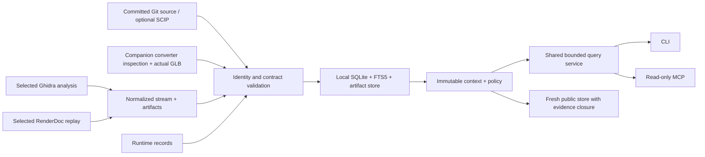

# Architecture and ownership

One independent Rust package owns identity, validation, storage and queries. CLI and optional rmcp stdio use the same query service. Analyzer exporters and the companion converter produce input records; they do not own query semantics or review decisions.

The retained `crates/knowledge-graph`, `research/knowledge-graph`, and `scripts/knowledge-graph` layout keeps the implementation and embedded contract paths stable. The workspace has no engine, Bevy, converter, renderer or analyzer dependency. `Cargo.lock` pins only its dependency closure.

| Module | Owns |
|---|---|
| `ids.rs`, `model.rs` | Canonical content identity and typed wire records |
| `bundle.rs` | Bundle/stream, schema, ontology, identity, evidence and dependency validation |
| `store.rs`, migrations | Atomic import, artifact publication, contexts, history, reviews and caches |
| `query.rs` | Context/policy filtering, search, adjacency, trace, citation closure and byte bounds |
| `source.rs` | Pinned Git indexing, SCIP positions, structural declarations, authored concept selectors |
| `material.rs` | Inspection DTO/actual GLB import, original shape joins and manifest lineage |
| `observations.rs` | Loaded-module code identities and session-scoped heap observations |
| `proposals.rs` | Explicit proposed relationships and context-scoped conflicts |
| `export.rs` | Fresh filtered store, remapped identities, permitted closure and notices |
| `main.rs`, `mcp.rs` | CLI parsing and optional read-only transport |
| Python exporters | Selected API extraction and exact normalized-stream/artifact output |

## Identity and evidence

[IDENTITY.md](../research/knowledge-graph/contracts/IDENTITY.md) defines framed full SHA-256 IDs and canonical JSON: bounded integers, no floating-point JSON payloads, sorted keys, exact UTF-8 bytes. Float values are retained as explicit bit/string representations when required. Paths retain case and reject traversal/platform escapes.

A source identifies origin, rights and lineage. Its immutable snapshot includes revision, selection, extraction settings, versions, capabilities and dependencies. Nodes and assertions belong to snapshots; evidence resolves to immutable artifact bytes and typed locators. Native function identity includes module hash/address-space/RVA, capture resources include capture hash, and heap addresses are scoped to an observation session. Mutable names never replace those identities.

A context selects exact snapshots under a policy. Queries take a read snapshot of store generation/reviews so one response does not mix changing decisions. Import collisions fail atomically; unchanged reimports are idempotent. Append-only reviews preserve extracted/manual/hypothesis origin. Old context IDs remain queryable after an alias moves.

## Contracts and transport

[The contract index](../research/knowledge-graph/README.md) links the schemas and ontology. Single-file bundles and normalized five-file JSONL streams share semantic validation. Streams pin exact byte hashes, sizes and counts. Required endpoint/evidence/dependency closure and visibility are validated before publication. Embedded schemas and the actual SQL migrations are shipped with the binary.

The [storage contract](../research/knowledge-graph/contracts/storage.sql) is the reviewed baseline; subsequent implementation migrations add indexes, parse cache and explicit conflict support. Update them compatibly and test old contexts. The [ADR](adr/0010-research-knowledge-graph.md) explains choosing local SQLite adjacency/FTS5 over a remote graph service.

Trust boundaries live in the responsible layer: import validation, store publication, contextual query policy and fresh export. Row-level filtering is not OS isolation. [Privacy](privacy.md) documents operator classification and client-export limits.
